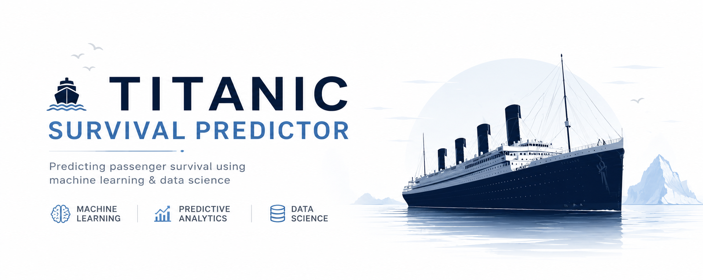
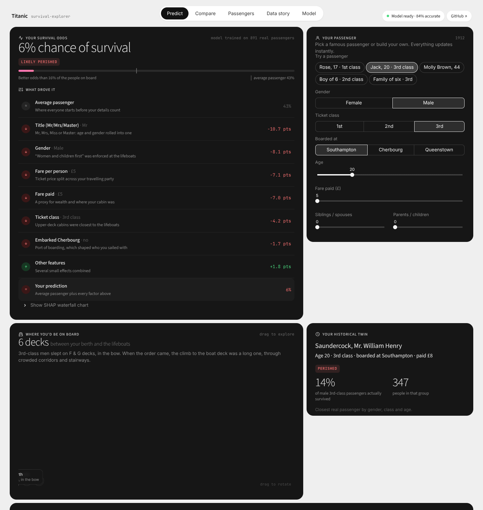
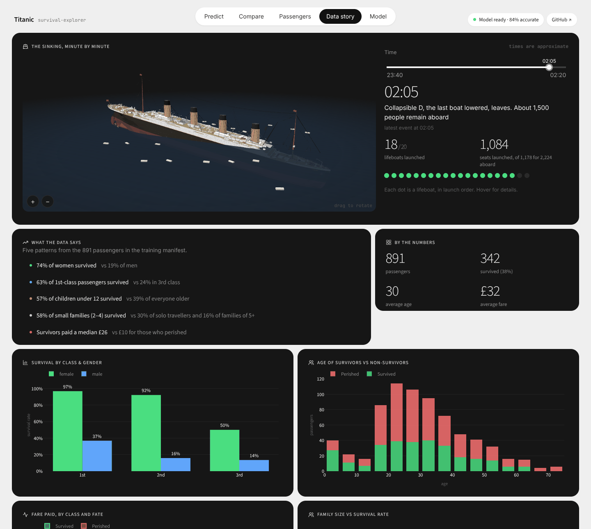
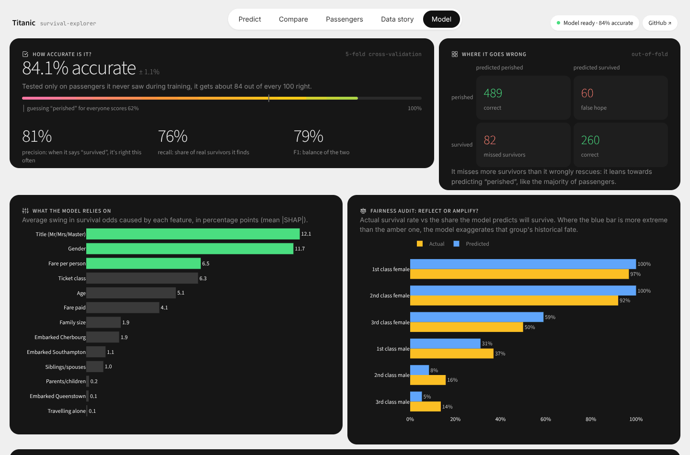
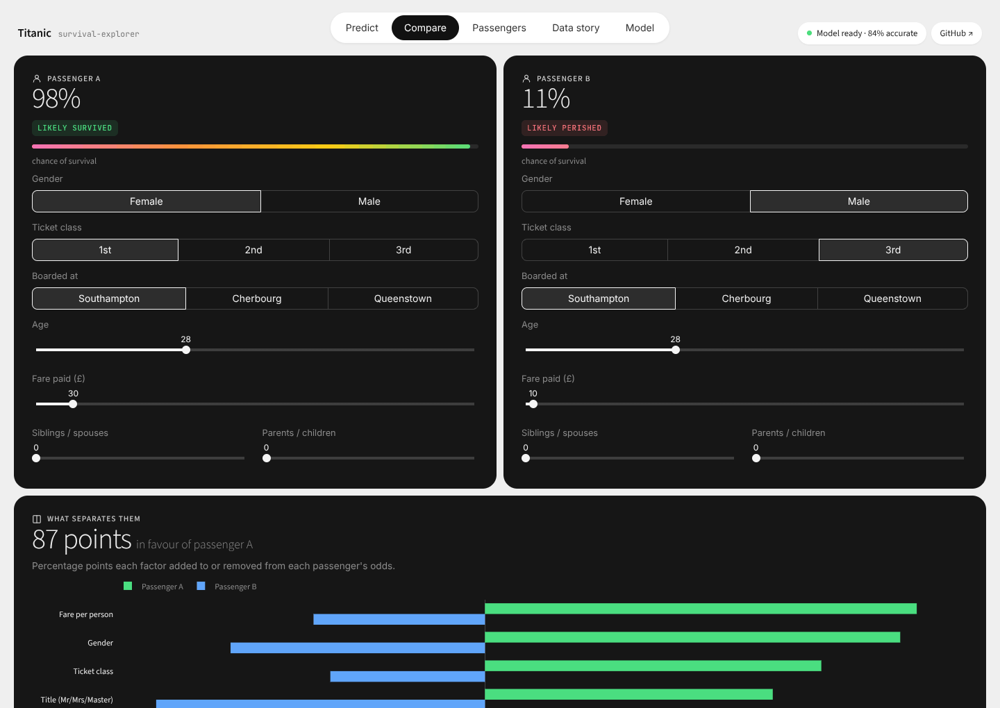
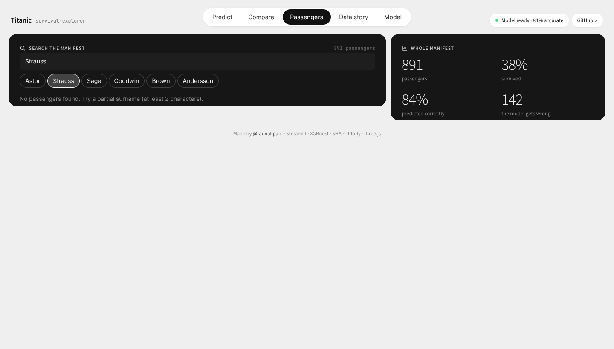

# 🚢 Titanic Survival Predictor



> An interactive ML explainability dashboard: XGBoost + SHAP + Streamlit, with a 3D Titanic you can explore

[](https://titanic-survival-predictor-raunak.streamlit.app/)
[](https://python.org)
[](https://xgboost.readthedocs.io)
[](https://shap.readthedocs.io)

---

> **Most Titanic projects stop at "I got 80% accuracy."**
> This one asks: _what actually drove each prediction, and what does that tell us about fairness, bias, and the human cost of class inequality?_

---

## 📸 Screenshots

### Predict: would you survive?
Pick a famous passenger or build your own. The prediction is broken down factor by factor in plain language, and a 3D model of the ship shows where you'd have slept compared with the lifeboats.



### Data story: the sinking, minute by minute
Scrub through the night of 14–15 April 1912. The ship pitches and sinks as lifeboats are launched, with every boat's launch time and seats.



### Model: how accurate, and how fair?


<details>
<summary>Compare and Passengers tabs</summary>




</details>

---

## ✨ Features

| Tab | What you can do |
|-----|----------------|
| **Predict** | Survival probability with a plain-language SHAP breakdown, your berth on a 3D Titanic, your historical twin, and how the model rates real passengers like you |
| **Compare** | Two profiles side by side, with the gap in percentage points and what causes it |
| **Passengers** | Search all 891 passengers by name and see their real fate next to an honest, out-of-fold prediction |
| **Data story** | An interactive 3D sinking timeline, key findings, and survival by class, gender, age, fare and family size |
| **Model** | Cross-validated accuracy, precision and recall, where it goes wrong, what it relies on, a fairness audit and a model card |

---

## 🧠 What makes the numbers honest

- **Out-of-fold everything.** Accuracy, precision, recall, the confusion matrix, the fairness audit and the Passengers tab all use predictions from a model that never saw that passenger during training (stratified 5-fold CV), never training-set scores.
- **SHAP in probability space.** Contributions are in percentage points and add up exactly to the prediction: average passenger + every factor = your odds.
- **One feature pipeline.** Training and inference share `build_features()`, so what the model learns and what it's asked can't drift apart (covered by a test).
- **Reflect vs amplify.** The fairness audit compares the actual survival rate of each class/gender group with the share the model predicts will survive. The model pushes groups towards extremes: it predicts 100% survival for 2nd-class women (actual 92%) and about 5% for 3rd-class men (actual 14%).

---

## 🛠 Tech stack

| Layer | Technology |
|-------|-----------|
| Model | XGBoost classifier |
| Explainability | SHAP TreeExplainer (interventional, probability output) |
| Evaluation | Stratified 5-fold cross-validation, out-of-fold predictions |
| Visualisation | Plotly, plus three.js for the 3D ship (vendored, no CDN needed) |
| App | Streamlit with a custom minimal design system (`ui.py`) |
| Data | [Kaggle Titanic competition](https://www.kaggle.com/competitions/titanic), downloaded automatically |

---

## 📁 Project structure

```
titanic-survival-predictor/
├── app.py               # Streamlit app (5 tabs)
├── ui.py                # Design system: CSS, Plotly template, card/row/stat helpers
├── model.py             # Training + CV, probability-space SHAP, simulator
├── data_utils.py        # Loading, cleaning, shared feature pipeline, search
├── history.py           # Sinking timeline: lifeboat launches, events
├── ship.py              # Streamlit wrapper for the 3D viewer
├── ship_viewer/         # 3D viewer component (HTML + three.js + titanic.glb)
├── tools/
│   └── convert_ship.py  # Rebuilds titanic.glb from the original .3ds model
├── tests/               # pytest suite
├── requirements.txt
├── requirements-dev.txt # + pytest, and mesh tools for convert_ship.py
└── data/                # Not committed; downloaded on first run
```

---

## 🚀 Run locally

```bash
git clone https://github.com/raunakpatil/titanic-survival-predictor.git
cd titanic-survival-predictor
pip install -r requirements.txt
streamlit run app.py      # data is downloaded on first launch, no Kaggle account needed
```

Run the tests with `pip install -r requirements-dev.txt && pytest`.

### The 3D ship

`ship_viewer/titanic.glb` (2.4 MB, ~127k triangles) is generated from a 111 MB `.3ds` model of the Titanic
(2.4M triangles). To rebuild it, or tune the detail level:

```bash
pip install -r requirements-dev.txt
python tools/convert_ship.py path/to/titanic.3ds ship_viewer/titanic.glb --faces 150000 --cell 0.25
```

Berth and lifeboat positions are approximate, taken from the ship's deck plans. Lifeboat launch times
are approximate too, since the British and US inquiries disagree by several minutes.

---

## 📊 Key findings

- **74% of women survived, against 19% of men.** Gender and title are the model's two biggest factors.
- **63% of 1st-class passengers survived, against 24% in 3rd class.** 3rd-class men slept six decks below the lifeboats.
- **57% of children under 12 survived**, against 39% of everyone older.
- **Small families (2–4 people) fared best** at 58%, against 30% for solo travellers and 16% for families of five or more.
- **Only 1,178 lifeboat seats for 2,224 people**, and many boats left part-empty: Lifeboat 1 carried 12 people in 40 seats.

---

## 🃏 Model card

| | |
|---|---|
| **Model** | XGBoost classifier · 200 trees, depth 4 |
| **Training data** | Titanic train.csv · 891 passengers |
| **Features** | Sex, Pclass, Age, Fare, SibSp, Parch, Embarked, FamilySize, IsAlone, Title, FarePerPerson |
| **CV accuracy** | ~84% ± 1% (stratified 5-fold) |
| **Precision / Recall** | ~81% / ~76% (out-of-fold) |
| **Known bias** | Class and gender dominate. That reflects documented historical inequality, but the model also sharpens those gaps (see the fairness audit) |
| **Intended use** | Educational and portfolio use only |
| **Not intended for** | Any real-world decision-making |

---

<div align="center">
Made with ❤️ by <a href="https://github.com/raunakpatil">@raunakpatil</a>
</div>
